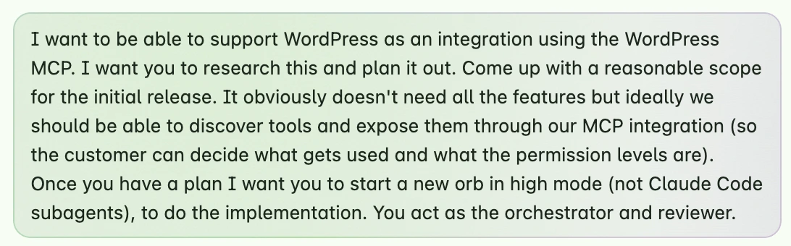
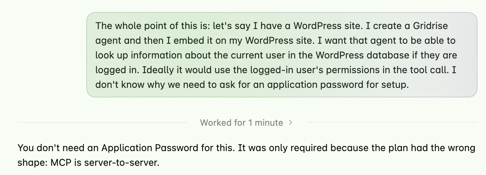
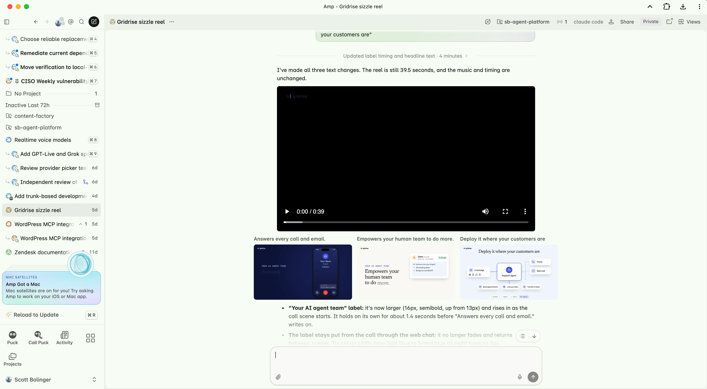

## On difficulty building SaaS

Writing the code for a full SaaS app used to be incredibly difficult. Over a decade ago I built my first SaaS business, AppPresser, and it took months with a team to cobble something together. I built Gridrise.io (AI agents for businesses) in my spare time with a full time job and family, and the UI and code quality is so much better it’s hard to overstate. I mostly worked from 6-8am every morning, and some nights and weekends.

It still took months because I have very little free time, plus I was planning, reviewing, and iterating constantly for every step. I didn’t write any code myself, but I wouldn’t call it vibe coded. I planned and reviewed each step, and was heavily involved. I was not writing small prompts and letting agents build while I slept, we are not quite at the point where agents can make good product decisions.

## Isn’t SaaS dead?

Lots of SaaS products are in decline, but if you think your local plumber or teacher is using Claude to connect to everything via MCP, you are blind. Most people still need an interface to look at, and will for a long time.

You can interact with Gridrise via MCP, but I still expect most people to use the UI.

## On cost

The total cost is laughable, I have a $100/month ChatGPT subscription, $20/month for Claude, and $20/mo for Amp. There are negligible costs for the infrastructure, but I’m still mostly on free tiers. I can’t believe how much you can do for that little.

## On the hard things

The hard things are still hard, and AI can’t help. Choosing the right product to build, what features matter the most, getting customers, building delightful human interfaces, and differentiating your product are hard. You can’t prompt your way out of these.

## On agent autonomy

One of the biggest lessons I learned in this process was how to give agents more autonomy. I’m letting agents run longer, with less supervision, and less initial instruction. We are now at a point where agents can execute complex tasks, in concert with other agents, and review and push code without human intervention. Despite the hype, this is a fairly recent development.

Agents and harnesses have come a long way since the Ralph loop. A year ago, giving an agent a task and letting it run all night was a recipe for disaster. The models weren’t good enough, and the harnesses weren’t good enough. Now, I find myself letting agents run for hours, with a good plan and a way to verify the work.

I haven’t had a major incident with an agent deleting data or going rogue.

## On prompting

Older models used to need lots of specific technical instructions so they didn’t go off the rails. Now giving too much instruction constrains the model to your own personal limitations, it’s better to give it a goal.

Here’s an example, I recently added a WordPress integration to Gridrise. Here was my prompt:

This was a mistake because we ended up not using the WordPress MCP at all, that was the wrong approach. I had to clarify later:

The agent replied: “You don't need an Application Password for this. It was only required because the plan had the wrong shape...”

If I had instead started with a user story, the agent would have gotten it right the first time. My technical instruction made things worse. This is not always the case, sometimes agents need correction, but newer models are getting better and better at making good technical decisions.

## On verification

The reason I can let agents run longer now is because they can verify their work beyond just automated tests.

Agents can use a browser, make screen recordings, and do everything you would do to verify the work. When I asked for the WordPress integration above, the agent installed a fresh copy of WordPress in its cloud environment, ran my integration, took a screen recording of it working, screenshots of the settings page, and gave me a full breakdown. There was nothing else I needed to do to verify the work. There’s no reason not to let agents push to production when they have all the context they need and they can verify their work like this.

## On access

To let agents run autonomously, they need access. They need to be able to login to your app, access your database, read support transcripts, and do everything you would be able to do. This can be scary, but it’s the way forward. Everywhere you limit access means you need a human to babysit an agent, and it cripples your ability to move quickly.  This is a huge advantage for startups because big companies can’t do this, even if they want to.

## On the best way to use agents

How to get a good result from an agent:

- Use a good frontier model
- Communicate clearly what you want
- Give the agent access to gather context
- Get indisputable verification of the work

As of this writing, using open weight or cheaper models is not a good idea unless you have a very specific use case. There are no hacks for GPT 6.1 sol to be as good as Opus 5.5 at a variety of complex tasks. It’s not about skills, plan mode, or any other hacks, just use a better model.

## On models

When I started this project, GPT 5.6 was the best model available. I had to be really specific on what I wanted the agent to do, and use skills and reviews to keep it on track. It was terrible at design, and I went through several redesigns and ended up with something ok, but not great. When Opus 5.5 came out, all of that changed. Opus is clearly better than me at coding and design, so I had it redesign and review everything. The result is extraordinary.

## On harnesses

A harness is like ChatGPT or Claude Code, it’s your interface for talking to the agent and getting an output. Not all harnesses are created equal. I’ve used Claude Code, Codex, T3, Pi, and Amp. Amp is by far the best because everything you work on is an isolated cloud container called an Orb. The orbs can talk to each other, so I have them setup to orchestrate multiple orbs together for planning, building, and reviewing. Amp agents have all the concepts in this article built-in, and I’m always impressed with the results.

## On automation

One of the cool things you can do with Amp is schedule agents to wake up at a certain day/time and do things without you prompting. I have a CISO that does a regular security scan and fixes major vulnerabilities, a CMO that reminds me to do things like write blog posts and send out emails, an engineering lead that can spawn subagents to complete our tasks for the day, and one-off agents for random tasks. In amp these are persistent threads in the cloud called Orbs.

## On free stuff

Currently I’m giving away free accounts to a few businesses that want to try it out. If you know anyone who needs an agent to answer the phone or chat on your website during off hours, schedule appointments, or answer questions, sign up here: https://gridrise.io/#early-access

## What is Gridrise?

A place for businesses to build a customer facing agent team that answers the phone, chats on the web, and responds in their support inbox. I’ve been building customer facing agents that have millions of interactions for 2 years, so I wanted to put my expertise to work for small businesses.

